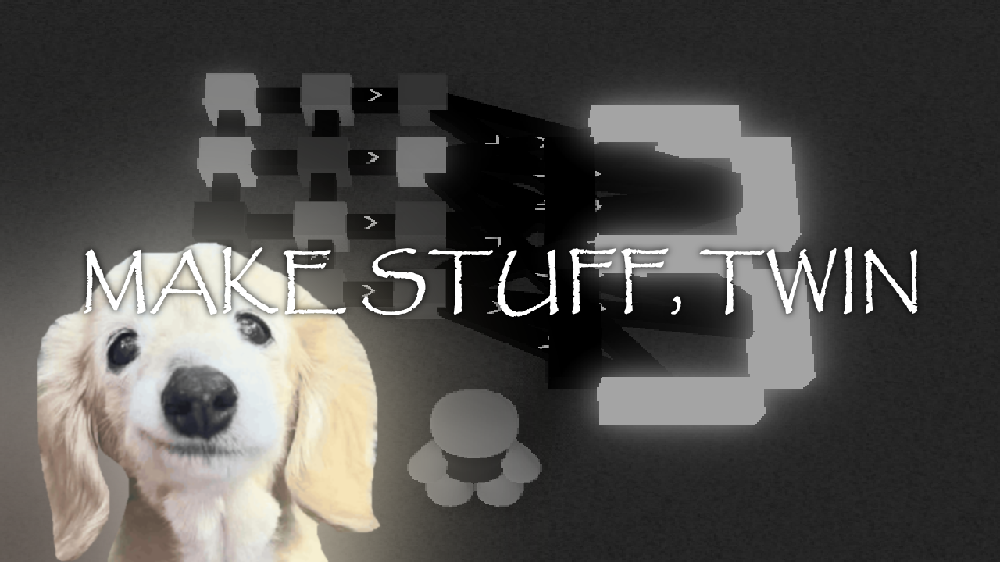

## Untitled Circuit Building Game (UCBG)
[UCBG](https://polytoria.com/places/140234) is a game made on the [Polytoria](https://polytoria.com) platform.

There is a community-managed Wiki here: https://polyucbg.miraheze.org/wiki/Main_Page  
You can join the official Discord server here: https://discord.com/invite/d2c8TZCR62

### Polytoria Deploy
UCBG uses [PTDeploy](https://github.com/little-meow-meow/polytoria-deploy), a workflow that automatically uploads releases to Polytoria.  
You can view the workflow [here](https://github.com/little-meow-meow/polytoria-deploy) and the UCBG usage [here](.github/workflows/deploy.yml).

### Contributing
UCBG is open to contributions, and encourages users to make Pull Requests!  
For more information, view [CONTRIBUTING.md](CONTRIBUTING.md).

### Licensing & Cloning / Forking
UCBG Source is provided under the [AGPL-3.0 License](https://www.gnu.org/licenses/agpl-3.0.en.html#license-text)

As per AGPL-3.0, anyone is allowed to Clone/Fork UCBG, as long as their copy is ALSO open-source under AGPL-3.0.

I'm not going to be super strict about the licensing, so if you do make local copies and someone requests the source-code for your game,
you are required to provide it. Because of that, I would highly recommend making a Fork of UCBG so it's publicly available on GitHub, and
using Visual Studio Code or Git to push all of your changes to your public repo.

___

Last but not least,

Make stuff, twin.
